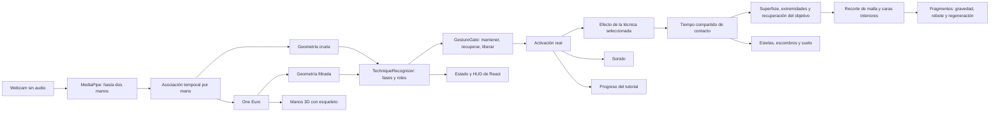

# Arquitectura del laboratorio 3D

La interfaz, los datos de la webcam y el render tienen responsabilidades diferentes. React organiza la sesión; Three.js dibuja sin depender de que React renderice cada fotograma. El filtro suaviza las manos visibles, mientras la evaluación exige también que los datos sin filtrar satisfagan el gesto.

`HandTracker` limita la inferencia a 20 llamadas/s, sin cola. `HandContinuity` asocia muñecas antes de filtrar, descarta asignaciones ambiguas y evita suavizar una mano con el historial de otra. Esta asociación es una heurística de continuidad, no una identificación garantizada.

`GestureGate` recibe muestras con identidad temporal y fecha de captura. El primer fotograma no suma tiempo. Las pérdidas cortas pausan; una postura visible incorrecta reinicia; una pérdida larga descarta la carga. Tras disparar, hay recuperación y apertura continua de una mano observada. La pausa conserva esa obligación.

`TechniqueRecognizer` selecciona la plantilla según la técnica y controla las fases de Fusión/Púrpura. Compara posturas y distancias tanto en datos crudos como filtrados. Asigna los papeles Azul/Rojo por gesto y conserva sus IDs durante la secuencia, sin depender del orden de resultados o de la etiqueta izquierda/derecha. Cada fase requiere su propio mantenimiento; los eventos intermedios no activan el efecto final ni puntúan. Hay una ventana de 10 s entre fases. Tras una técnica bimanual, la liberación exige ambas manos abiertas.

`LabController` coordina cámara, sesión, audio y escena. Solo un evento `fire` del reconocedor aumenta el contador. La función de depuración reproduce el efecto por otra vía y nunca completa el tutorial.

Al entrar a la guía se prepara `HandTracker`. Jugar inicia directamente la cuenta atrás si está listo; de lo contrario conserva una intención de inicio hasta recibir el estado listo. Esa intención se cancela al pausar, cambiar de técnica, volver al menú, apagar la cámara o perder visibilidad. El permiso/modelo no acumula tiempo de cuenta atrás. La conexión se conserva al ir al menú y entre técnicas; se pausa la inferencia y se limpian manos/efectos. Apagar cámara y `pagehide` detienen el stream y liberan el modelo. No hay petición de cámara al montar la aplicación.

`TrainingScene` controla el bucle de render y libera geometrías, texturas, materiales y render targets al cerrar. `HandRig` genera mallas con 21 huesos y pesos de piel. Su colocación corresponde a un plano de interacción virtual frente a la cámara 3D; no mide las coordenadas de la habitación. `GojoEffects` coordina los efectos, y `DomainEffect` dibuja el vacío, estrellas y anillos. El dominio desvanece los materiales del entorno y los restaura al terminar, pausar o cambiar de técnica; los personajes permanecen en la escena.

| Técnica | Estado local | Interacción |
| --- | --- | --- |
| Gojo / Azul | Tutorial y práctica libre implementados | Dos dedos, esfera y atracción animada |
| Gojo / Rojo | Tutorial y práctica libre implementados | Índice, onda y repulsión |
| Fusión Azul + Rojo | Entrenamiento preparatorio implementado | Dos manos: energías separadas y convergencia |
| Gojo / Púrpura | Tutorial y práctica libre implementados | Fusión ordenada y gesto final; proyección e impacto |
| Gojo / Dominio | Tutorial y práctica libre implementados | Dos dedos próximos; vacío estelar y objetivo inmóvil |
| Sukuna / Desmantelar | Tutorial y práctica libre implementados | Preparación, trazo lateral de la punta del índice y mantenimiento final |
| Sukuna / Sesgar | Tutorial y práctica libre implementados | Palmas abiertas separadas y convergencia, cortes cruzados |
| Sukuna / Fuga | Tutorial y práctica libre implementados | Preparación bimanual y cambio a puño/índice, flecha de fuego |
| Sukuna / Santuario | Tutorial y práctica libre implementados | Gesto bimanual sostenido, santuario procedural y cortes |
| Yuji / Puño Divergente | Tutorial y práctica libre implementados | Preparar puño, desplazar y frenar; dos impactos y caída |
| Yuji / Destello Negro | Tutorial y práctica libre implementados | Preparar puño, desplazar y frenar; rayos negros/rojos y fragmentación |
| Megumi / Perros Divinos | Tutorial y práctica libre implementados | Gesto bimanual de índice/meñique, aparición y ataques de dos perros |
| Megumi / Nue | Tutorial y práctica libre implementados | Preparación con palmas próximas y apertura de alas, descarga y caída |
| Megumi / Totalidad, Sapo, Elefante y Conejos | Tutorial y práctica libre implementados | Invocaciones propias: garras, captura, agua y distracción sin heridas |
| Megumi / Mahoraga | Ritual de invocación implementado | Dos puños sostenidos, rueda/espada y exorcismo escenificado |
| Megumi / Jardín Azabache de las Quimeras | Dominio abierto implementado | Puños/apertura de manos, campo fluido, dobles, shikigamis y hundimiento |

El catálogo conserva sus adaptaciones. La opción detallada añade criterios de Rojo, dominio de Gojo, una variante de proyección de Púrpura y la mano del arco de Fuga, con referencias y límites documentados en [VISUALS.md](VISUALS.md). Los clips aportados por el usuario pueden servir para contrastar las demás posturas y documentar su fuente.

| Fase | Criterio observable |
| --- | --- |
| Base técnica | TypeScript y build correctos; modelo y WASM locales |
| Tutorial 3D | Menú, guía, webcam, manos y objetivo visibles en navegador |
| Reconocimiento | Gesto mantenido activa una vez; puño y palma abierta no activan |
| Repetición | Recuperación y mano abierta permiten la siguiente técnica |
| Sesión | El objetivo propio de cada tutorial se completa con activaciones reales; depuración no puntúa |
| Validación humana | Cinco personas, ambas manos, dos iluminaciones, errores y latencia registrados |
| Catálogo | Evaluar y calibrar cada técnica con personas antes de afirmar fiabilidad |

La implementación está separada de la evidencia de validación. Consulta [VALIDATION.md](VALIDATION.md) para saber qué criterios se han comprobado automáticamente y cuáles necesitan webcam y revisión visual.

La versión 0.4 añade `SwipeTracker`: verifica la trayectoria lateral de Desmantelar en datos crudos y filtrados, con ventana temporal, desplazamiento normalizado, rechazo de saltos y tolerancia al mantener el final. El mantenimiento del índice por sí solo no activa el corte. Sesgar, Fuga y Santuario utilizan plantillas bimanuales; Fuga admite que las manos originales intercambien sus papeles al cambiar de postura.

La versión 0.5 comparte la cronología en `combatTimeline.ts`. `TechniqueEffects` conserva el inicio y el origen de la activación; actualiza el efecto del personaje, `CombatAccents` y el estado que recibe `CurseActor`. La reacción es una función del tiempo transcurrido: saltar o repetir un render no duplica impulsos. Los impactos se dirigen a un objetivo virtual fijo. Azul usa un foco de atracción próximo al objetivo; Rojo, Púrpura, cortes y fuego coordinan su llegada con la respuesta del receptor. El modelo de la maldición usa materiales propios con disolución/cortes/quemadura, incluidos los contornos, y extremidades articuladas. Pausa y cambio de técnica restauran inmediatamente su estado.

`posePrecision.ts` valida los umbrales de la opción detallada, definidos en JSON. `TechniqueRecognizer` exige sus condiciones sobre datos crudos y filtrados. Cambiar esa opción interrumpe la carga parcial y conserva el bloqueo de recuperación/liberación. Las referencias de cada guía están separadas de la evaluación geométrica en `poseGuidance.ts`; una referencia de escena no certifica la fidelidad de una adaptación. Las manos 3D no se ajustan a una plantilla: siguen sus puntos observados y ofrecen anclas de energía en los dedos.

La revisión 0.6 separa `TechniqueSpectacle`, `ImpactLens` y `CurseDestruction`. La primera reutiliza volúmenes con ruido fractal, cintas trianguladas y hasta 9.000 partículas cuyo movimiento calcula el shader. La segunda aplica una onda de refracción localizada después del bloom y antes del tone mapping de salida. El modo ligero omite ambos pasos de postprocesado y reduce partículas/fragmentos.

`fractureGeometry.ts` lleva las superficies reales del objetivo a coordenadas locales, recorta sus triángulos contra planos, suelda las intersecciones y triangula las tapas con orientación opuesta para cada mitad. Las piezas conservan normales y colores de superficie y tienen interiores propios. Se preparan conjuntos de dos mitades, trama de hasta 18 celdas y trama densa de hasta 72; no se recorta la malla en cada fotograma. `destructionMotion.ts` define el tipo de destrucción por técnica y trayectorias balísticas analíticas con rebotes y fricción. No es un motor general de cuerpos rígidos: las interacciones con suelo son aproximadas y no hay colisiones entre piezas.

`CurseDestruction` sustituye la figura intacta por fragmentos durante cortes/explosión, escalona el desprendimiento en Santuario y usa partículas de superficie para Púrpura/cenizas. `persistentTargetTimeline` mantiene el objetivo sin recuperación automática y deja asentados los fragmentos. El reloj de la presentación termina normalmente; el del objetivo permanece hasta el respawn explícito. Pausar conserva una instantánea del objetivo. El controlador bloquea ataques nuevos mientras permite completar la liberación de manos. Respawnear no reinicia ese requisito ni suma puntuación. El último ataque desbloquea el tutorial al terminar; su pantalla final espera al respawn. Nuevas sesiones y cambios de objetivo preparan un modelo intacto. La vista previa de impacto sigue el mismo ciclo manual.

Vacío Infinito añade `head-burst` cuando quedan 2000 ms de dominio (6000 ms con la duración actual de 8000 ms). `combatTimeline` calcula ese instante en `CombatState.contactMs`, que comparten destrucción y partículas y se conserva en la instantánea del objetivo. La apertura y parálisis siguen usando `CONTACT_MS.domain` a los 1000 ms. Los constructores agrupan cabeza y accesorios en `Curse head parts`. `CurseDestruction` prepara fragmentos exclusivamente de esas superficies, conserva el cuerpo y oculta la cabeza intacta al estallar. Los restos comparten las trayectorias balísticas existentes y esperan al respawn; onda y fogonazo respetan reducción de destellos/intensidad. Las vistas previas sin impacto no destruyen el objetivo.

`VoidHeadEffect` añade presión con tres anillos durante los 650 ms anteriores a `state.contactMs` y partículas muestreadas de la cabeza en ese instante. Los buffers se reutilizan y la calidad ligera baja de 480 a 128 partículas. Las vistas previas sin impacto y la intensidad cero no activan esta energía; cancelación/respawn limpian su visibilidad.

`TechniqueEffects` selecciona `GojoEffects` o `SukunaEffects`. Los dos modelos de personaje se crean por separado y solo se muestra el elegido. Cambiar de personaje interrumpe las fases, limpia el efecto y restaura los materiales del escenario. Los tutoriales se conservan en un registro común con claves distintas por técnica, migrando los datos antiguos de Gojo.

`TrainingScene.setTechnique` aplica el personaje a ambos `HandRig`. `anatomicalHand.ts` genera cuatro pieles continuas y cerradas con palma, pulgar, dedos y nudillos, con tendones en relieve, pliegues y contorno deformable. `handSkeleton.ts` define los 21 huesos; las matrices calculan giro y estiramiento de falanges conservando las anclas observadas. La etiqueta izquierda/derecha refleja la anatomía con compensación de puntos locales. `handAppearance.ts` define paleta y accesorios; `CharacterHandDetails` orienta uñas volumétricas, marcas y puños con el movimiento real. Las anatomías se construyen al necesitarlas y se almacenan; alternarlas reutiliza su geometría y el esqueleto. Los accesorios se ocultan con la mano; el cierre libera las variantes creadas e instancias y deduplica los esqueletos de piel/contorno. Véase [CHARACTER_HANDS.md](CHARACTER_HANDS.md).

Yuji usa `PunchTracker` para comprobar el desplazamiento lateral del centro del puño en datos crudos/filtrados después de una preparación sostenida. `Yuji.ts` anima guardia, avance y puñetazo; `YujiEffects` reutiliza aura, cintas, rayos volumétricos e impactos. `yujiTimeline.ts` comparte contactos con `SoundEngine` y `combatTimeline`: Divergente da dos golpes a 460/780 ms y termina con caída persistente; Destello Negro contacta a 620 ms y activa la fragmentación existente. Las cuatro maldiciones, el progreso y el respawn utilizan el mismo flujo de sesión. Véase [YUJI.md](YUJI.md).

Megumi añade el patrón individual `wolf` y las relaciones bimanuales de `shadowConfig.ts`, evaluados en crudo/filtrado con la asociación existente. `Megumi.ts` anima al invocador; `shadowShikigami.ts` construye perros y Nue articulados; `MegumiEffects` reutiliza modelos, portales, niebla, trazos y electricidad. `megumiTimeline.ts` comparte contactos con audio/objetivo: primer y segundo perro a 1350/1750 ms, desgarro en el segundo, descarga de Nue a 1600 ms y cuerpo oscurecido/caído. Véase [MEGUMI.md](MEGUMI.md). La ampliación de seis técnicas se separa en `ExpandedShadowEffects` y `expandedShikigami.ts`: modelos y recursos reutilizados, agua/lengua dinámicas, conejos instanciados y dobles rígidos horneados. `combatTimeline` comparte captura, arrastre, distracción y hundimiento con el objetivo; el dominio restaura el entorno y conserva la marca del receptor hasta respawn. Los efectos genéricos de explosión/distorsión se omiten en Conejos y Sapo. Véase [MEGUMI_EXPANSION.md](MEGUMI_EXPANSION.md).

`SwipeTracker` observa la punta del índice en píxeles, con escala de palma y acuerdo entre datos crudos/filtrados. `swipeConfig.ts` concentra sus límites: recorrido de 0,9 palmas, ventana de 3 s, tres avances observados y estabilización de 150 ms antes del mantenimiento final. Continuar un barrido ya válido descarta solo el mantenimiento, conservando la preparación. La tolerancia de postura de 200 ms no acredita carga ni movimiento inválidos; los umbrales angulares relajados se aplican solo a `slash-sweep`. El mensaje del reconocedor muestra avance y frenado. No se cambian los puntos observados para fabricar un gesto válido.

`ShrineDomain` incorpora el GLB local aportado por el usuario y controla su carga diferida, fallback, reintento, aparición, niebla y polvo. `shrineTimeline` dirige la apertura antes del contacto compartido a 2600 ms. `ShrineCamera` muestrea una pose absoluta, ajusta el plano general a la proporción de pantalla y restaura exactamente la cámara al salir. El modelo permanece estático internamente: no tiene rig ni mandíbula independiente. La preparación y créditos se describen en [SHRINE_MODEL.md](SHRINE_MODEL.md).

SoundEngine.updateCasting recibe el progreso válido de todas las técnicas y arranca la voz tras 100 ms acumulados, antes del disparo. El estado de audio permanece al activar el ataque. GojoSequenceAudio permite una voz activa: Azul, Rojo o fusión, con paneo de la mano asignada y cancelación por generación. TechniqueRecognizer fija primero el ID de Azul; después acepta Rojo en una mano distinta y mantiene ambos papeles para convergencia/proyección. Véanse [GOJO_AUDIO.md](GOJO_AUDIO.md) y [SUKUNA_AUDIO.md](SUKUNA_AUDIO.md).

Las cuatro técnicas de Sukuna comparten ahora el límite de reproducción con su efecto y un desvanecimiento de 180 ms. `mediaRemaining` detecta tres segundos sin avance del decoder para liberar Fuga aunque conozca una duración larga. Los audios personalizados no generan esperas por su duración desconocida. El orden de Fuga1/Fuga2 se conserva.

La invocación se coordina mediante SoundEngine.prepareRelease/releaseWaitMs. Púrpura utiliza HOLLOW_PURPLE_RELEASE_MS = 3000, marca de «Murasaki» aportada por el usuario, y el currentTime del audio; no calcula la espera por la duración completa. GojoSequenceAudio retiene la reproducción en esa marca si aún falta el gesto final y armLaunch permite continuar tras validarlo. La proyección comienza sin otra carga; combatTimeline, effectTimeline y GojoEffects comparten contacto a los 850 ms. El audio continúa desde la fusión y comparte el límite de reproducción con la animación, con desvanecimiento final de 180 ms. Los audios personalizados no heredan la marca de voz del archivo incluido. LabController conserva un lanzamiento pendiente solo tras reconocimiento completo; TrainingScene.freezeCasting mantiene el ancla de energía y permite ocultar manos sin inventar seguimiento. DeliverAttack activa el efecto, suma la activación y reinicia la recuperación del reconocedor en el lanzamiento. Fusión mantiene su espera anterior y Fuga encola su segunda voz hasta terminar la primera. Pausa/salida cancelan audio y espera; mute, errores o tres segundos sin avanzar no bloquean Púrpura. La interfaz indica las invocaciones en el HUD, sin aviso central, y oculta la guía de dedos durante el ataque y hasta el respawn.
